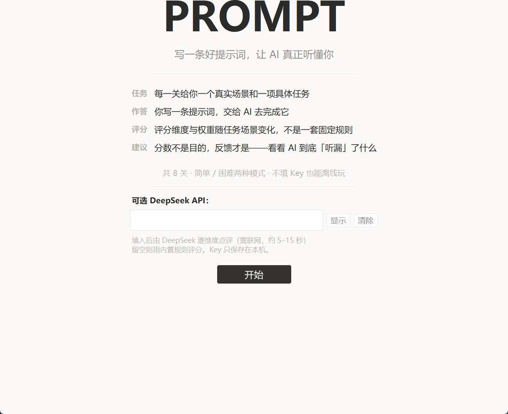
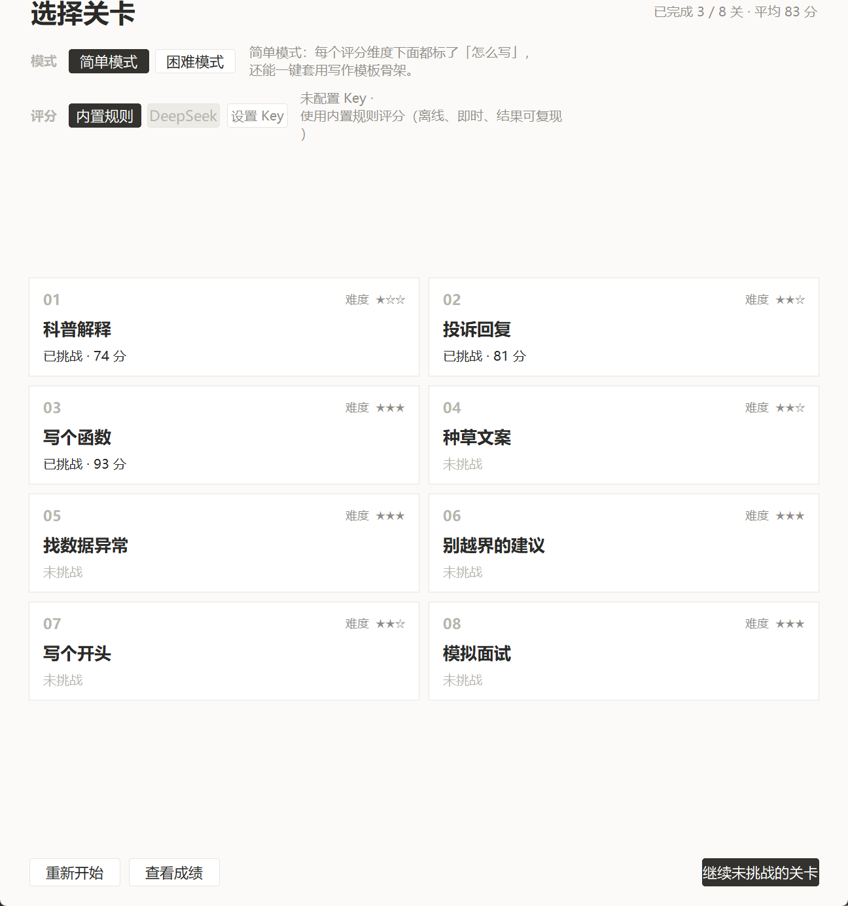
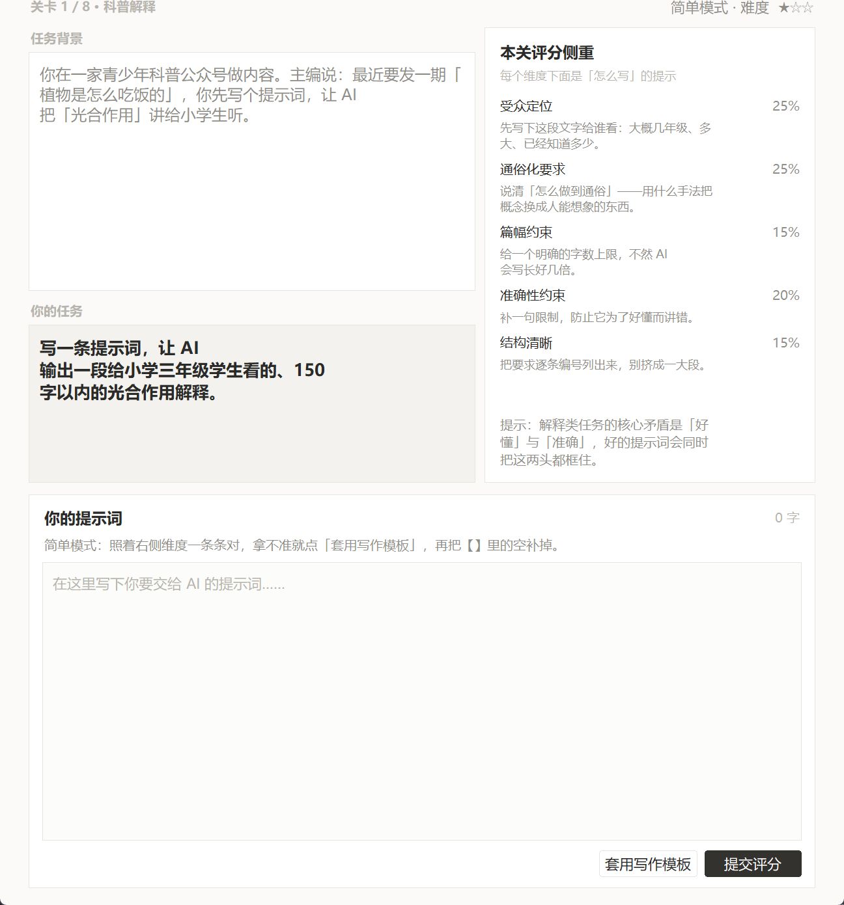
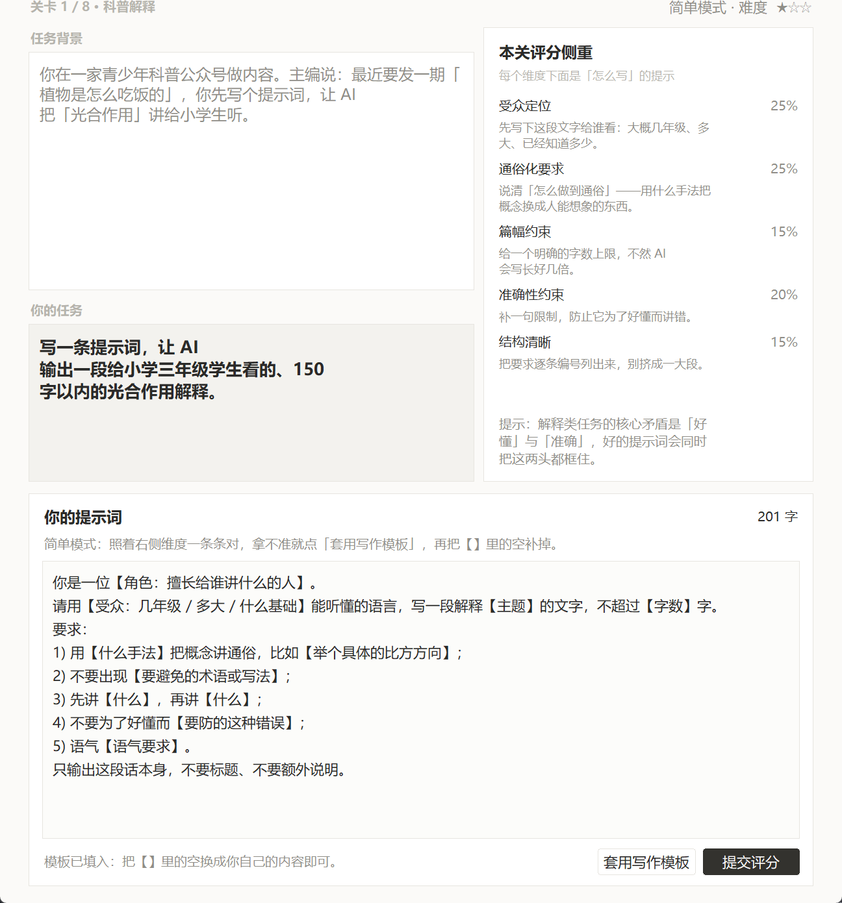
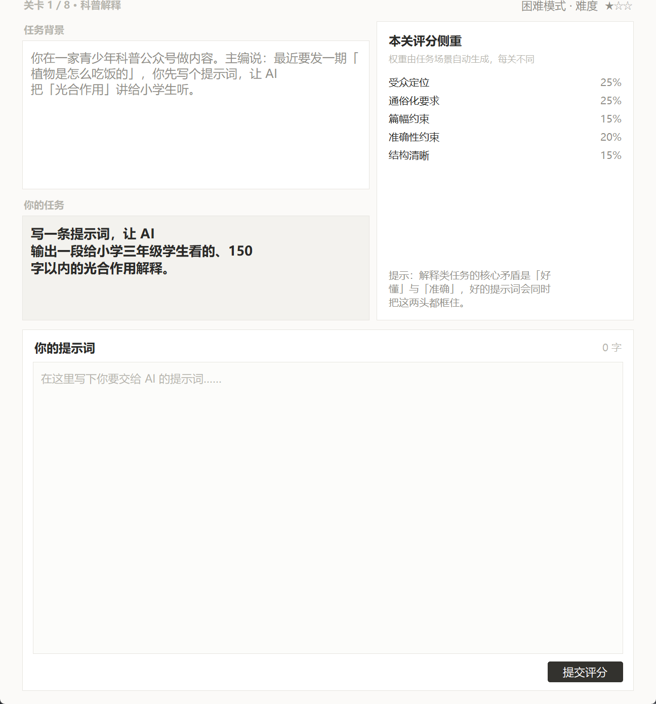
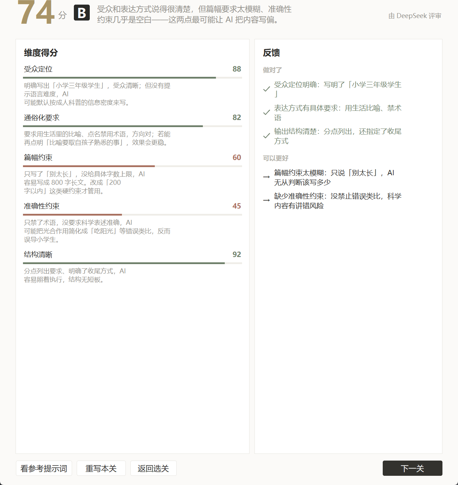
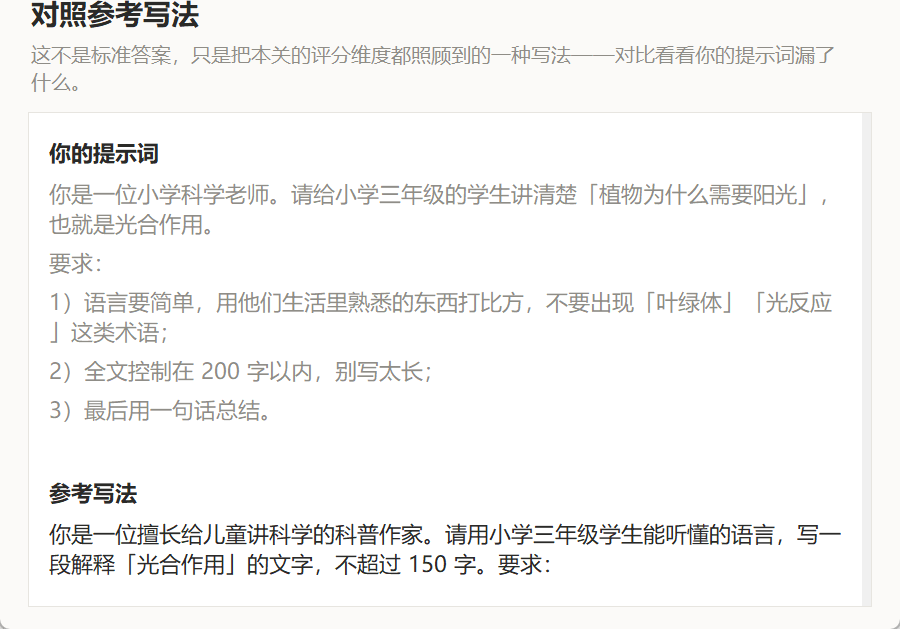
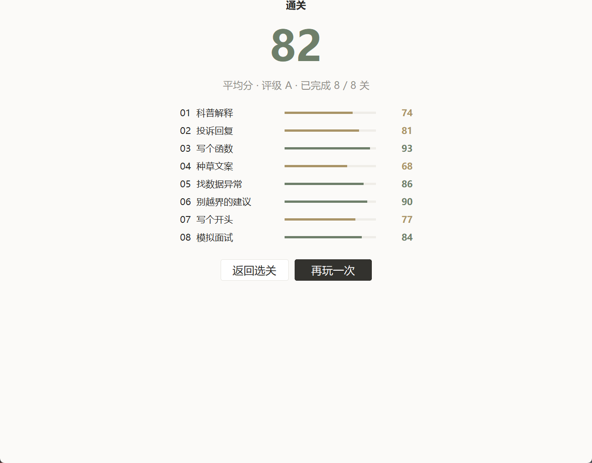

# PROMPT · 提示词训练游戏

> 写一条好提示词，让 AI 真正听懂你。

一个 Windows 单机小游戏。每关给你一个**真实任务场景**和一项**具体任务**，你写一条提示词交上去，系统按**这一关自己的评分维度与权重**打分，并逐项告诉你：漏了哪条要求、漏掉会导致什么后果。

**8 关 · 简单/困难两种模式 · 不填 API Key 也能离线玩**

<p>
<a href="https://github.com/AlanSong1/PROMPT-Gamev1.0/releases/latest/download/PROMPT.exe">
  
</a>
</p>

> **一键下载** → [**点此直接下载 PROMPT.exe**](https://github.com/AlanSong1/PROMPT-Gamev1.0/releases/latest/download/PROMPT.exe)
> 免安装、双击即玩、约 11 MB。如果浏览器提示风险，选择"保留"即可（未签名的个人项目，属正常提示）。
> 全部版本：[Releases](https://github.com/AlanSong1/PROMPT-Gamev1.0/releases)

---

## 界面预览

**开始页** — 不填 Key 也能玩，填了则由模型来评分



**选关页** — 8 关进度一目了然，可任意跳关，不必从头打起



**关卡页（简单模式）** — 右侧列出本关评分侧重，每个维度下面直接标了「怎么写」



拿不准就先点「套用写作模板」，把 `【】`里的空换成你自己的内容：



**关卡页（困难模式）** — 同样的任务，只给维度和权重，不给任何提示



**评分页** — 逐维度给分 + 具体点评，右上角标明这次由谁评分



**对照参考写法** — 你自己的提示词和参考写法并排放，对照着看漏了什么



**结算页** — 整轮成绩单，可返回选关接着打没挑战的关卡



---

## 玩法

1. 读「任务背景」和「你的任务」；
2. 在下方写一条提示词，点「提交评分」；
3. 看分数不是重点，**看反馈**才是——每个维度会告诉你命中了什么、漏了什么；
4. 不满意可以「重写本关」，或点「查看结算」看整轮成绩单。

## 8 个关卡

| # | 关卡 | 让你写什么 | 本关权重最高的维度 |
|:-:|:--|:--|:--|
| 1 | 科普解释 | 让 AI 给小学三年级学生讲清光合作用 | 受众定位 / 通俗化要求（各 25%） |
| 2 | 投诉回复 | 起草一封安抚顾客的回复邮件 | 事实要素（25%） |
| 3 | 写个函数 | 让 AI 写出校验手机号的 Python 函数 | 功能规格 / 边界与异常（各 25%） |
| 4 | 种草文案 | 产出一篇可直接发布的小红书笔记 | 人群与卖点（25%） |
| 5 | 找数据异常 | 从数据里找出「需要关注的异常及原因」 | 方法要求（25%） |
| 6 | 别越界的建议 | 回复既要**有用**、又要**守住安全边界** | **安全边界（35%）** |
| 7 | 写个开头 | 写一段 300 字以内的微型小说开头 | 创意方向 / 风格与氛围（各 25%） |
| 8 | 模拟面试 | 设定角色与规则，让 AI 连续多轮提问并反馈 | **规则与流程（30%）** |

---

## 「评分随场景自适应」是怎么做的

这是这个项目的核心。**评分标准不写死在算法里，而是跟着关卡走**——每关自带一张维度权重表，合计 100，并且开场就摊在「本关评分侧重」面板里让你看见。

所以同样是「安全」这件事，在关卡 6（医疗健康建议）里**安全边界独占 35%**，因为那个场景下「不许诊断、不许开药」才是第一优先级；而在关卡 1（科普）里它只占 20%。

效果可以直接验证：把同一句泛泛的提示词

> 你是一名专业助手，请认真完成，注意格式，要准确。

丢进 8 个关卡，得分是 **0 / 18 / 2 / 0 / 12 / 1 / 1 / 12**（第 1~8 关）——同一句输入撞上八张不同的表，分数从 0 到 18 分不等。而 8 份内置参考写法的自评是 **93~100 分**。

两种评分方式都支持：

| 方式 | 说明 |
|:--|:--|
| **内置规则**（默认） | 离线、即时、不花钱，同一输入永远同一分数，结果完全可复现 |
| **DeepSeek**（可选） | 填入 API Key 后由模型逐维度评审，点评会具体到你的原文，约 2~4 秒 |

> 内置规则的本质是「按场景换标准、按命中情况挑话」：它按**加权损失**（权重 × 漏掉的分）排序，
> 所以同样漏两项，权重 35% 的安全边界一定排在权重 10% 的结构清晰前面——
> 看起来像"懂这个场景"，其实是它按金额大小报账单。

## 两种模式

- **简单模式**：每个评分维度下面都标了「怎么写」，还有「套用写作模板」一键填入写作骨架（`【】`留给你补）。
- **困难模式**：只给任务和评分维度，不给任何提示——靠自己想清楚。

## 可选：接自己的 DeepSeek Key

开始页或选关页都能填，Key 只保存在本机 `~/.prompt_game.json`（明文，界面上有说明）。
不填就走内置规则，随时可切。**任何环节出问题都会自动降级**到内置规则并说明原因（Key 无效、余额不足、断网、返回格式不对都试过），不会让你卡在"评审中"。

---

## 从源码运行

需要 Python 3.10+（含 tkinter，Windows 官方安装包默认自带）：

```bash
python prompt_game.py
```

想自己改关卡内容，编辑 `prompt_game.py` 里开头的 `TASKS` 段即可；简单模式的提示在 `HINTS`，
写作模板在 `TEMPLATES`，评审口径在 `AI_SYSTEM`。

<details>
<summary>项目结构</summary>

```
prompt_game.py            # 全部逻辑：关卡数据、评分引擎、界面（单文件）
docs/screenshots/         # README 用截图
LICENSE
```

</details>

## 已知局限

这是原型，短板说清楚：

- **内置规则是字面匹配**。你写「用孩子听得懂的说法」，而词表里只有「通俗 / 简单 / 口语」，就拿不到分——同义表达是盲区。想要语义理解，请切到 DeepSeek 评分。
- **区分度偏粗**。信号维度命中一个关键词就有 50 分，要三个以上才接近满分。
- **结构分各关同一套公式**，其实还可以按场景分化（比如数据分析那关应该更重表格）。
- **界面排版的小瑕疵**：tkinter 不做中文「避头尾」，标点偶尔会被断到行首。

## License

[MIT](LICENSE) —— 随便用，改成你自己想要的样子也行。
